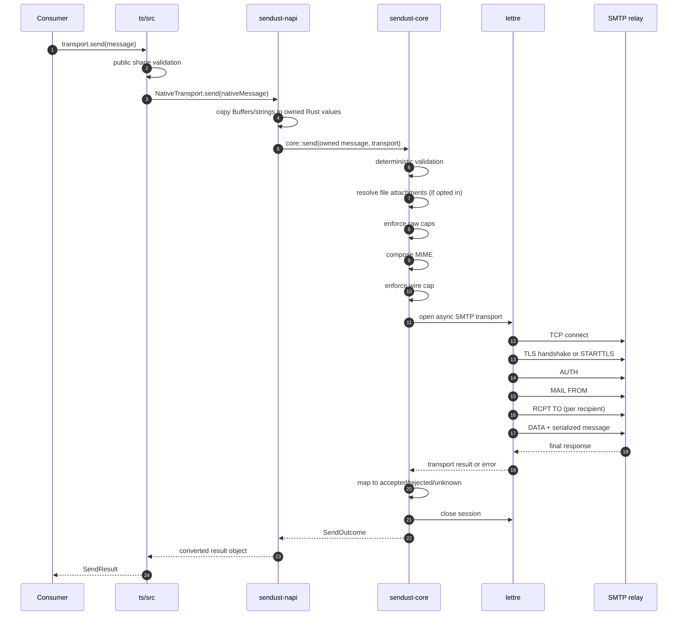
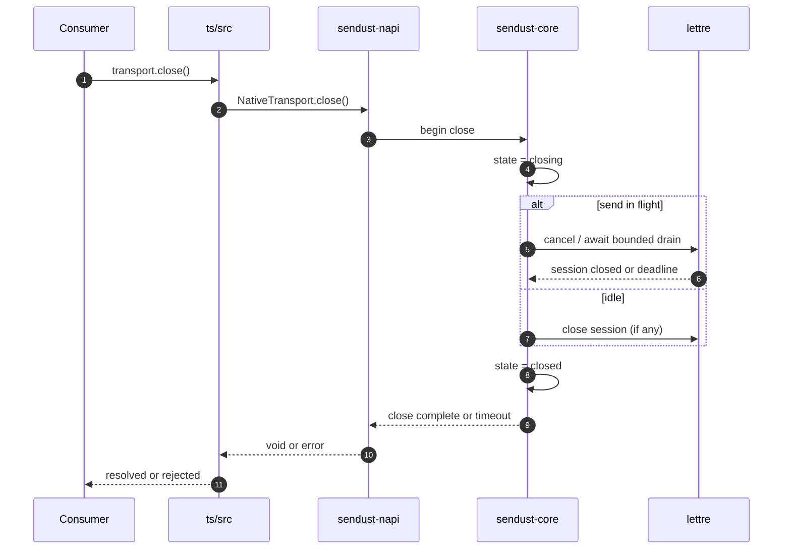

# Sendust — Data Flow

This document traces a single `send` call and a `close` call across the four layers. It defines what is copied, when, and which failures are possible at each boundary.

## 1. Send flow



### 1.1 Ownership at each step

| Step | Input ownership | Output ownership | Copied? |
| --- | --- | --- | --- |
| JS call | JS heap | JS heap | — |
| Wrapper validation | JS heap | JS heap | No |
| napi conversion | JS heap | Rust heap | Yes, every buffer/string |
| Core validation | Rust heap | Rust heap | No |
| File attachment read | OS file | Rust heap | Yes, bounded |
| MIME composition | Rust heap | Rust heap | Serialized bytes |
| lettre submission | Rust heap | lettre internal | lettre serializes to socket |
| Result conversion | Rust heap | JS heap | Values only, no bodies |

**Invariant:** after the napi conversion returns to the async runtime, no pointer into JS-owned memory is retained. A JS mutation or `ArrayBuffer` detachment after the call cannot alter sent bytes. This is tested in P05-002 and P11-004.

### 1.2 Validation and composition happen before network

All deterministic failures (validation, limits, configuration, MIME composition, wire cap) occur before the first TCP connection. This guarantees:

- A rejected input never opens a socket.
- `BUSY` never dials the relay.
- Tests can assert zero SMTP transactions for invalid input.

### 1.3 SMTP stage certainty

| Stage | If it fails | Result certainty |
| --- | --- | --- |
| TCP connect | No SMTP session established | Connection/transport error; no delivery outcome exists |
| TLS handshake | Trust or negotiation failed | `TLS` error; no message was submitted |
| AUTH | Authentication failed | `AUTH` error; no message was submitted |
| MAIL FROM | Definitive SMTP refusal | `rejected` outcome |
| RCPT TO | Recipient refusal | Policy per ADR-0005; envelope is not sent if policy requires abort |
| DATA command | Server refuses DATA before message body | `rejected` outcome |
| DATA body transmission | Connection lost or write result leaves acceptance uncertain | `unknown` only when acceptance cannot be ruled out |
| Final response | Explicit final 4xx/5xx | `rejected` outcome |
| Final response | Positive 2xx | `accepted` outcome |
| Final response | No final reply after terminator may have reached relay | `unknown` outcome |

A result is `accepted` only after a positive final response to DATA. An explicit negative final response (4xx/5xx) is a known `rejected` outcome, including when it arrives after the message body. `unknown` is reserved for cases where the final disposition cannot be established, such as losing the connection after the DATA terminator may have reached the relay but before its final reply arrives. Connection, TLS, and AUTH failures are operational errors, not delivery outcomes. Acceptance means relay responsibility, not mailbox delivery.

## 2. Close flow



Rules:

- `close()` is idempotent; repeated calls return the same completion.
- The drain is bounded by the close budget (125 s default).
- `close()` never waits for garbage collection and is never triggered by GC.
- A send started during `closing` fails with `CLOSED` and does not dial.
- A close during a maximal send (120 s) still has 5 s of drain headroom.

## 3. Error path

```text
core error
  ├── ValidationError        -> sync throw at wrapper
  ├── ConfigurationError     -> sync throw at wrapper
  ├── LimitError             -> sync throw at wrapper
  ├── TlsError               -> async rejection
  ├── AuthenticationError    -> async rejection
  ├── ProtocolError          -> async rejection or Unknown outcome
  ├── TimeoutError           -> async rejection
  ├── TransportClosedError   -> async rejection
  ├── TransportBusyError     -> async rejection (no I/O)
  └── InternalError          -> async rejection, generic message
```

The binding maps core categories to stable JS classes and codes. It strips:

- passwords and auth tokens,
- full message bodies,
- attachment bytes,
- absolute local paths,
- internal Rust panic payloads.

It preserves:

- SMTP numeric response code and server text where safe,
- timeout category and elapsed budget,
- recipient addresses (already caller-supplied),
- host and port.

## 4. Data flow limits

| Point | Limit applied | Failure mode |
| --- | --- | --- |
| Recipient list | 100 total | `LIMIT_RECIPIENTS` before connect |
| Each buffer attachment | 10 MiB | `LIMIT_ATTACHMENT_BYTES` before MIME |
| All raw attachments | 20 MiB | `LIMIT_ATTACHMENT_TOTAL` before MIME |
| File read | per-file cap + 1 probe | `LIMIT_ATTACHMENT_BYTES` |
| Serialized message | 30 MiB | `LIMIT_WIRE_BYTES` before DATA |
| Active sends | 1 | `BUSY` before connect |
| Close drain | 125 s | `TIMEOUT_CLOSE` |

No limit is enforced after bytes have been written to the socket except the total send deadline.

## 5. Backpressure and memory

- The MVP buffers the entire message before sending. There is no streaming.
- Peak memory is approximately: owned message inputs + serialized wire bytes + lettre’s internal encoding buffer.
- Caps are chosen so worst-case peak remains bounded and documented (see P13-003 for measured numbers).
- Attachment files are read with a bounded read loop; a file that grows during read is detected by the cap probe and rejected.
- No global state, no cross-transport cache, no pool.
