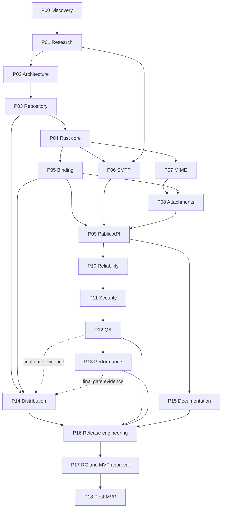

# Dependency Graph

Two views: the phase graph used for planning, and the critical-path task graph used for execution. Both are acyclic. Task-level prerequisites are authoritative in the [task registry](task-registry.md).

## 1. Phase dependency graph

### Edge rationale

| Edge | Why |
| --- | --- |
| P00 → P01 | Research questions must be explicit and owned |
| P01 → P02 | Architecture cannot freeze unvalidated dependencies |
| P02 → P03 | Workspace layout follows the boundaries and policies approved at P02-005 |
| P03 → P04 | Core implementation needs toolchain, lints, and test seams |
| P04 → P05 | Binding adapts core types that must exist first |
| P04 → P06 | SMTP orchestration consumes core state, errors, and limits |
| P01 → P06 | TLS/auth/recipient decisions come from research |
| P04 → P07 | MIME consumes address, header, and limit models |
| P07 → P08 | Attachments are MIME parts with filename/content-type policy |
| P05 → P08 | Attachment bytes cross the binding and must be copied |
| P05 → P09 | Public API calls the binding |
| P06 → P09 | Public API surfaces SMTP outcomes and errors |
| P08 → P09 | Public API accepts attachments |
| P09 → P10 | Reliability hardens the public contract and lifecycle |
| P10 → P11 | Security review needs the complete failure surface |
| P11 → P12 | QA verifies the security-hardened build |
| P12 → P13 | Performance measurement needs a stable, tested build |
| P03 → P14 | Early packaging smoke needs the workspace |
| P05 → P14 | Early packaging smoke needs a working binding |
| P09 → P15 | Documentation describes the public API approved at P09-005 |
| P12 → P14 (final gate) | Final distribution gate consumes QA evidence |
| P13 → P14 (final gate) | Final distribution gate consumes performance evidence |
| P14 → P16 | Release engineering needs a validated distribution matrix |
| P12 → P16 | Release candidate needs QA evidence |
| P13 → P16 | Release candidate needs performance evidence |
| P15 → P16 | Release notes and docs accuracy are release inputs |
| P16 → P17 | RC must be assembled and evidenced before approval |
| P17 → P18 | Post-MVP work starts only after MVP release closure |

P14 has a deliberate split: early tasks start after P03/P05, while P14-005 consumes P12-005 and P13-005. This avoids a phase-level cycle: P12/P13 do not depend on P14.

## 2. Critical path

The longest chain determines the minimum phase sequence:

```mermaid
graph LR
    A[P00-005] --> B[P01-001]
    B --> C[P01-003]
    C --> D[P02-002]
    D --> E[P02-005]
    E --> F[P03-005]
    F --> G[P04-005]
    G --> H[P06-005]
    H --> I[P09-005]
    I --> J[P10-005]
    J --> K[P11-005]
    K --> L[P12-005]
    L --> M[P13-005]
    M --> N[P16-005]
    N --> O[P17-005]
    O --> P[P18-005]
```

Notes:

- P01-003 is on the critical path because recipient and timeout semantics block the public contract.
- P07/P08 and P05 feed P09 in parallel with P06; the slower of those tracks determines when P09 can start. The plan treats P08 as the likely longer track because of filesystem safety and attachment tests.
- P14 early tasks are off the critical path but P14-005 is a merge point with P12/P13.
- P15 is off the critical path except for P15-005, which feeds P16.

## 3. Parallel tracks

| Track | Tasks | Can start after | Notes |
| --- | --- | --- | --- |
| A — SMTP | P01-001, P01-002, P01-003, P06-001–P06-005 | P00-005 | Depends on lettre research |
| B — Platform | P01-004, P05-001–P05-005 | P00-005 | Node lifecycle and binding |
| C — MIME | P04-002, P04-003, P07-001–P07-005 | P03-005 | Independent of SMTP |
| D — Attachments | P08-001–P08-005 | P07-005, P05-005 | Depends on MIME and binding |
| E — Public API | P09-001–P09-005 | P05-005, P06-005, P08-005 | Merge point |
| F — Distribution | P14-001–P14-003 | P03-005, P05-005 | Early smoke and metadata |
| G — Documentation | P15-001–P15-003 | P09-005 | Can proceed with P10–P14 |
| H — Hardening | P10, P11, P12, P13 | P09-005 | Sequential |

## 4. Cycle audit

| Check | Result |
| --- | --- |
| All phase edges point forward in the P00→P18 ordering | PASS |
| P14 early edges (P03/P05) precede P14 | PASS |
| P14 final gate evidence edges (P12/P13 → P14) do not create a return path | PASS; P14 has no edge to P12 or P13 |
| P16 consumes P12/P13/P14/P15, none consume P16 | PASS |
| P17 consumes P16 only | PASS |
| P18 consumes P17 only | PASS |
| Task prerequisites reference earlier tasks or earlier phases | PASS; see registry audit below |

## 5. Task prerequisite audit rules

The following rules are enforced when the registry changes:

1. A task prerequisite must exist in the registry.
2. A task prerequisite must belong to the same phase with a lower sequence number, or to an earlier phase.
3. The only allowed same-phase exception is a gate task depending on all earlier tasks in its phase.
4. Cross-phase prerequisites must point to a gate task or a task explicitly named in the phase plan.
5. A phase cannot be marked `COMPLETED` while a downstream phase has begun work that assumes it.

## 6. How to update this graph

When a task dependency changes:

1. Update the phase plan.
2. Update the task registry.
3. Update this graph if a phase edge changed.
4. Re-run the cycle audit.
5. Record the change in the phase gate record.

## Architecture Amendment A01 dependency

A01-001–A01-004 are a documentation/research amendment chain completed before P03. P03-001 now depends on P02-005, A01-004, and A02-003. P05 and P14 retain their phase positions but their acceptance criteria now include blocking Node.js, Bun, and Deno tests and runtime × platform evidence. A01 does not add a new implementation phase or change the P00–P18 phase numbering.

## Architecture Amendment A02 dependency

A02-001–A02-003 define and review modular module ownership, dependency rules, and the implementation handoff. P03-001 depends on A02-003 in addition to P02-005 and A01-004. P03/P04 establish and validate the modular core structure; P06 validates the SMTP adapter boundary; P12 audits module ownership and test coverage. A02 adds no implementation phase and does not alter the P00–P18 phase ordering.
